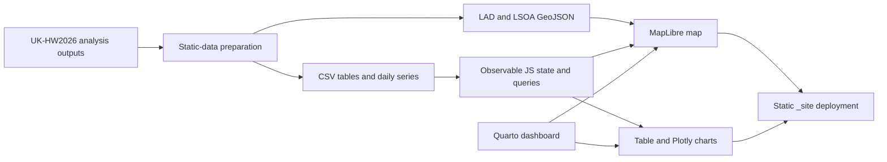

# UK Heatwave 2026: Excess Mortality Explorer (`UKHW2026-app`)

[](https://quarto.org/)
[](https://observablehq.com/)
[](https://maplibre.org/)
[](LICENSE)
[](https://app.netlify.com/projects/uk-hw2026/deploys)

An interactive dashboard presenting heat-related excess mortality associated with the record-breaking summer 2026 heatwaves in England and Wales, covering 1 May to 30 September 2026.

The underlying analysis uses an established small-area environmental epidemiology framework developed at the **London School of Hygiene & Tropical Medicine (LSHTM)**. It links ERA5-Land and ERA5 reanalysis temperatures to age- and LSOA-specific temperature–mortality functions across **34,753 Lower Layer Super Output Areas (LSOAs)** in England and Wales.

**Live app:** <https://ehm-lab.github.io/apps/uk-hw2026/>

## Interpretation note

The results are **modelled estimates of heat-related excess mortality**, not observed counts from complete 2026 death registrations. The geographical coverage is England and Wales, despite the historical `UKHW2026-app` repository name.

## Key findings

- **Overall burden:** An estimated **5,827 heat-related excess deaths** (95% empirical confidence interval [eCI]: 4,349–6,897), equivalent to **97.6 per million**, occurred across England and Wales during the study period.
- **Concentration in five identified heatwave periods:** The five periods accounted for an estimated **5,325 deaths (91.4%)**. The largest period totals were for 18–28 June (**1,808 deaths**) and 6–17 July (**1,468 deaths**).
- **Older age groups:** People aged 75 years and over accounted for an estimated **4,408 deaths (75.7%)** (95% eCI: 3,367–5,334), while representing 8.7% of the population used in the analysis.
- **Peak daily estimates:** The highest modelled daily totals were on 26 June (**409 deaths**; 95% eCI: 306–475) and 13 August (**405 deaths**; 95% eCI: 276–479).
- **Regional variation:** All-age rates per million were highest in the West Midlands (**133.9**), South East (**133.0**) and London (**132.4**), and lowest in the North East (**41.7**).

## What the dashboard shows

- A full-study-period map of all 348 Local Authority Districts (2011 boundaries).
- LSOA maps for each of the five identified heatwave periods after a local authority is selected.
- A sortable summary table with England-and-Wales-level and regional estimates and 95% eCIs.
- Comparisons across the nine English regions and Wales.
- Age-group comparisons and a daily England-and-Wales time series.
- Download of the currently filtered summary table as CSV.

The summary table and CSV download contain England-and-Wales-level and regional results. Selecting a local authority changes the map but not the table or download. Detailed LAD- and LSOA-level outputs are available in the [study repository](https://github.com/ehm-lab/UK-HW2026).

## Methods in brief

- The assessment applies previously estimated age- and LSOA-specific temperature–mortality functions for England and Wales. These functions were derived from 2000–2019 data using distributed lag non-linear models with lags of 0–21 days.
- The assessment covers 34,753 LSOAs (2011 boundaries) and uses 2020 LSOA populations and 2024 regional age-specific mortality rates.
- Daily mean 2-m temperatures, adjusted to local time, were retrieved at LSOA centroids through the Open-Meteo Historical Weather API using ERA5-Land where available and ERA5 for coastal LSOAs where ERA5-Land data were unavailable.
- England-and-Wales-level and regional 95% empirical confidence intervals are based on 500 Monte Carlo samples of the model coefficients.
- The five identified heatwave periods differ in duration. For each period, the same calendar dates were applied to every LSOA. The periods were informed by UKHSA heat-health alerts and corresponding peaks in the LSOA-averaged temperature series. They are study-defined periods, not official UK-wide heatwave definitions:

  1. 22–28 May 2026
  2. 18–28 June 2026
  3. 6–17 July 2026
  4. 29 July–5 August 2026
  5. 11–15 August 2026

- LSOA maps show point estimates. Negative LSOA estimates are set to zero for mapping only; England-and-Wales-level and regional estimates are unchanged.
- Comparisons with other heat-mortality assessments should be descriptive because periods, data, methods and geographical coverage may differ.

For the full analytical workflow and input documentation, see the [study repository](https://github.com/ehm-lab/UK-HW2026).

## Application architecture



The deployed application reads precomputed CSV and GeoJSON assets. It does not run the mortality models in the browser.

## Repository structure

- `index.qmd` — current Quarto/Observable dashboard source.
- `styles.scss` — dashboard styling.
- `_quarto.yml` — Quarto configuration, external libraries and navigation links.
- `app_data/` — browser-ready summary, daily and spatial assets.
- `_site/` — rendered static site deployed by Netlify.
- `00_prep_static_data.R` — regenerates browser-ready tables and GeoJSON from prepared inputs.
- `00_prep_app_data.R` — maintainer-oriented spatial preparation pipeline; some geography paths refer to the LSHTM network environment.
- `netlify.toml` and `_headers` — deployment and caching headers.
- `app.R`, `R/` and `www/` — legacy Shiny prototype files; they are not used by the deployed Quarto application.

The `data/` directory is intentionally excluded from version control. The committed `_site/` directory contains the data assets needed to serve the current deployment.

## Running the current build locally

Serve the committed `_site/` directory over HTTP. For example:

```bash
cd _site
python -m http.server 8080
```

Then open <http://localhost:8080>. Opening `_site/index.html` directly as a `file://` URL will not work reliably because the application loads data asynchronously.

## Previewing or rebuilding from source

To preview `index.qmd`, first create `data/` and copy these two files from the study repository's `output/` directory:

- `lad_study_period.csv`
- `lsoa_hw_period.csv`

Then run:

```bash
quarto preview index.qmd
```

To regenerate the summary and daily browser assets, place the following prepared study outputs in `data/`:

- `national_age_period.csv`
- `region_age_period.csv`
- `national_mort_daily.csv`
- `national_t2m_daily.csv`
- `lad_study_period.csv`
- `lsoa_hw_period.csv`

Run:

```bash
Rscript 00_prep_static_data.R
quarto render index.qmd
```

Netlify publishes the committed `_site/` directory. After changing `index.qmd`, styles or data, render the dashboard and commit the updated `_site/` files as well as the source changes.

## License

This project is licensed under the [MIT License](LICENSE).
